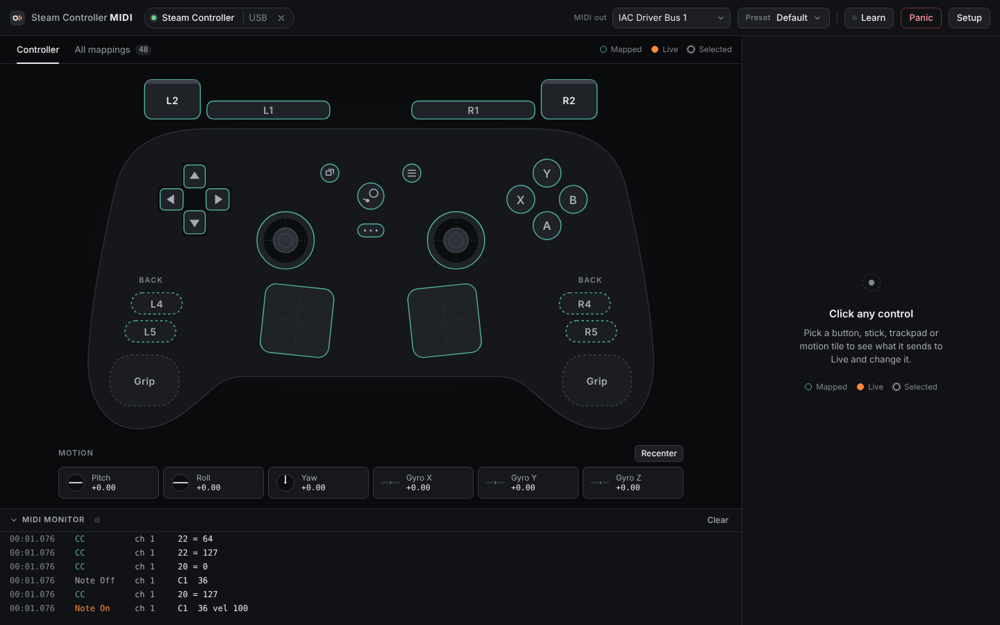

# Steam Controller MIDI

Turn every input on the 2026 Steam Controller into MIDI and play Ableton Live
with it: buttons, bumpers, analog triggers, both thumbsticks, both pressure-sensitive
trackpads, the four grip buttons, the capacitive touch sensors, and motion (tilt and gyro).



It runs in the browser (Chrome or Edge on a desktop computer). Nothing to install
except a virtual MIDI port, which Live needs in order to hear the app.

> **Status:** the controller protocol is taken from SDL's open-source driver and
> covered by tests against it, but this has not yet been run against a physical
> controller. If yours isn't recognised, open **Setup → Diagnostics**, press
> **Copy diagnostics**, and open an issue with the result.

## Three ways to run it

| | What it is | Best for |
| --- | --- | --- |
| **Standalone app** | A desktop app. On macOS it creates its own MIDI port, "Steam Controller MIDI". | Mapping Live's knobs and buttons (MIDI Map mode) and playing instruments. Keeps working with its window hidden. |
| **VST3 / AU plugin** | The same thing inside your DAW, saved with the project. | Playing instruments on a track. |
| **Web app** | Runs in Chrome or Edge, nothing to install. | Trying it out. |

Two things about Ableton Live worth knowing before you choose:

- Live's MIDI Map mode only listens to MIDI *ports*, never to plugins. To map
  Live's own parameters, use the standalone app (or the web app).
- Live does not accept MIDI from Audio Units. In Live use the VST3; the AU is a
  MIDI effect for hosts such as Logic.

### Get the app and plugins

Builds for macOS (universal) and Windows are produced by the **Native builds**
workflow: open the repository's Actions tab, pick the latest run and download
the zip under *Artifacts*. Each zip has an `Install.txt`. The builds are not
signed by Apple or Microsoft, so the first launch needs one extra step, which
`Install.txt` describes.

**Removing the macOS security steps.** The Mac builds open without any
Gatekeeper warning once they are signed with an Apple Developer ID
($99/year Apple Developer Program). In the repository's Settings → Secrets and
variables → Actions, add:

| Secret | What it is |
| --- | --- |
| `MACOS_CERTIFICATE_P12` | Your "Developer ID Application" certificate exported from Keychain Access as .p12, then base64-encoded (`base64 -i cert.p12 \| pbcopy`) |
| `MACOS_CERTIFICATE_PASSWORD` | The password you gave the .p12 when exporting |
| `APPLE_ID` | Your Apple ID email |
| `APPLE_APP_PASSWORD` | An app-specific password from appleid.apple.com |
| `APPLE_TEAM_ID` | Your 10-character team ID (developer.apple.com → Membership) |

The next build then signs, notarises and staples automatically. Without them
it falls back to the unsigned builds described in `Install.txt`.

To build them yourself (CMake 3.22+, a C++17 compiler, Node 22):

```bash
npm install
npm run build:native
cmake -S native -B native/build -DCMAKE_BUILD_TYPE=Release
cmake --build native/build --config Release
```

On Windows, install the WebView2 SDK first and pass its folder with
`-DJUCE_WEBVIEW2_PACKAGE_LOCATION=...` (see `.github/workflows/native.yml`).

> **Status of the native builds:** the Linux build of the standalone app and
> VST3 has been run and its interface exercised; the macOS and Windows builds
> and the Audio Unit have not been run by anyone yet.

## Run the web app

```bash
npm install
npm run dev
```

Open the address it prints (usually http://localhost:5173) in Chrome or Edge.

To publish it as a web page instead, enable GitHub Pages for the repository
(Settings → Pages → Source: GitHub Actions) and run the **Deploy to GitHub Pages**
workflow from the Actions tab.

## Set up with Ableton Live

1. **Create a virtual MIDI port.**
   - **macOS:** open *Audio MIDI Setup* → Window → Show MIDI Studio → double-click
     *IAC Driver* → tick *Device is online*.
   - **Windows:** install [loopMIDI](https://www.tobias-erichsen.de/software/loopmidi.html)
     and add a port.
2. **Quit Steam.** While Steam is running it treats the controller as a mouse and
   keyboard, which will click around in Live.
3. **Open the app, press *Connect controller*** and choose the Steam Controller in
   Chrome's dialog. Then pick your virtual port in the **MIDI output** menu.
4. **In Live:** Settings → Link, Tempo & MIDI. Find the virtual port under
   *Input* and switch on **Track** (to play instruments) and **Remote** (to map
   knobs and buttons).
5. **Map controls:** switch on **Learn** in the app, press Cmd+M (Ctrl+M on
   Windows) in Live, click a parameter in Live, then press **Send** on the
   mapping you want. Learn mode pauses the controller's own output, so a
   twitchy stick or the gyro can't grab the mapping by accident. Leave MIDI Map
   mode, switch Learn off, and play.

Keep the browser window open while you play. It can sit behind Live, but don't
minimise or close it.

## What you can map

| Input | Sends |
| --- | --- |
| A B X Y, D-pad, bumpers, stick clicks, View / Menu / Steam / Quick Access, grip buttons L4 L5 R4 R5, trackpad clicks, trigger full-pull | Note or CC, momentary or toggle |
| Stick touch, trackpad touch, grip sense (capacitive) | Note or CC, momentary or toggle |
| Triggers, stick X / Y, trackpad X / Y, trackpad pressure | CC, pitch bend, or a note fired at a threshold |
| Tilt forward/back, tilt left/right, yaw, gyro speed | CC or pitch bend, optionally only while a button is held |

Two extras for playing rather than just mapping:

- **Trackpad drum grid:** set a trackpad's Click (or Touch) mapping to Note and
  choose a 2 × 2, 3 × 3 or 4 × 4 pad grid. Each zone plays its own note, counting
  up from the mapping's note, bottom-left first, so a 4 × 4 grid starting at C1
  lines up with a Drum Rack.
- **Relative (endless knob) mode:** any axis can send up / down steps instead of a
  position. Swipe a trackpad to nudge a parameter from wherever it is, or push a
  stick to turn it at a speed. After mapping it in Live, set that mapping's mode
  to *Relative (2's Comp.)* in the bar at the bottom of Live's window.

More ways to play (0.2):

- **Velocity:** notes can take their velocity from how hard you press a
  trackpad, how far a trigger is pulled, or (for a trigger played as a note)
  how fast you pull it.
- **Note repeat:** hold a button to retrigger its note at 1/8, 1/16 or 1/32
  (straight or triplet), locked to Live's tempo in the plugin, or to the Tempo
  setting in the app.
- **Scale mode:** pick a key and scale per preset; buttons and pad grids then
  only play notes in it.
- **MPE trackpads:** each touch is its own voice on channels 2–16. Slide to
  bend, move up and down for CC 74, press harder for pressure. Enable MPE on
  the instrument in Live (right-click the device title → Enable MPE); Vital
  supports it.
- **Range:** tilt, yaw, gyro and the sticks have a range setting, for example
  a full filter sweep from a 20° tilt.
- **Haptics:** a short tap from the controller on every note, and in the
  plugin a metronome you feel on each beat or bar while Live plays.
- **Templates:** Drum kit, Synth performance (MPE) and Clip launcher presets.

Each mapping has its own channel, output range, invert, deadzone, response curve
and smoothing. Trackpad and gated mappings can hold their last value or snap
back to rest when you let go. An input can have several mappings.

The **Default** preset gives every input its own note (from C1, the first Drum
Rack pad) or CC (20-31, then 102 up) on channel 1, so it works with Live's MIDI mapping
straight away. Touch sensors and motion start switched off so they don't fire
while you're just holding the controller. Presets are saved in the browser and
can be exported and imported as files.

## Connections

- **USB cable** and the **wireless puck** are the most reliable.
- **Bluetooth** should work where the operating system exposes the controller to
  the browser, but is the least tested path.
- If the app can't open the controller directly, any controller the browser sees
  as a gamepad works in **limited mode**: sticks, triggers and standard buttons
  only, and only while the browser window is visible.

## Development

```bash
npm test        # unit tests for the protocol parser and mapping engine
npm run build   # type-check and build into dist/
```

- `src/core/` — no browser APIs: input catalog, HID report parser, mapping model,
  MIDI engine.
- `src/runtime.ts` — WebHID → engine → Web MIDI, driven by HID events so it keeps
  running in a background tab.
- `src/store.ts` — presets and connection status.
- `src/ui/` — the interface.
- `native/` — the standalone app and plugins (JUCE). `Source/Core.cpp` is a C++
  port of `src/core/`; `npm run fixtures` plus `native/Tests/parity.cpp` check
  that both produce identical MIDI. The interface is the same web UI, embedded
  and shown in a WebView, talking to the native side through `src/nativeRuntime.ts`.
